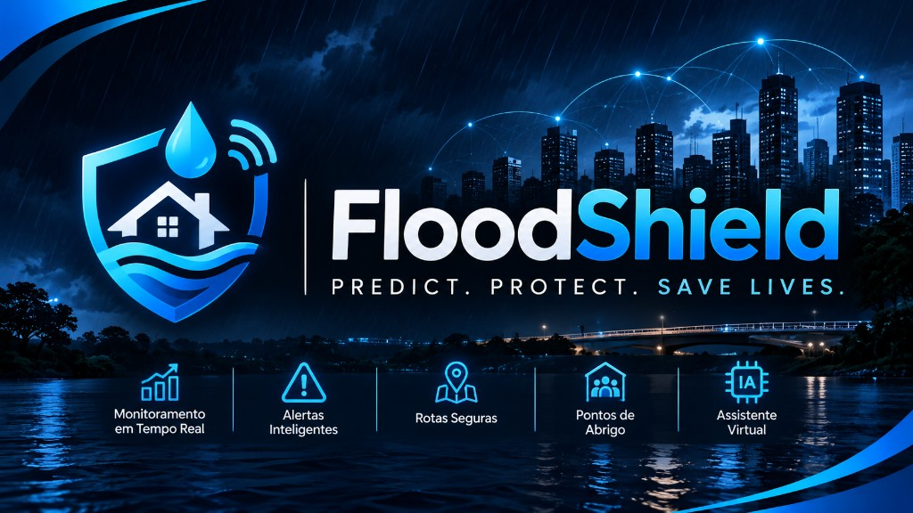

# FloodShield Mobile



**Predict. Protect. Save Lives.**

App React Native (Expo) da CitizenTech **FloodShield** — Global Solution FIAP 2026/2.

Repositório: https://github.com/FloodShield-2026/FloodShield_Mobile

## Equipe

| Nome | RM |
| --- | --- |
| Bruno Vinicius Barbosa | 566366 |
| Guilherme de Andrade Martini | 566087 |
| Nathan Gonçalves Pereira Mendes | 564666 |
| Raphael Gomes Mancera | 562279 |

## O que este app cobre (Mobile Application Development)

- Mínimo de **6 telas** com navegação (Expo Router)
- **CRUD** de ocorrências via API Java (`Axios`) — mock local até a URL subir
- **Autenticação** real (cadastro, login, logout, rotas protegidas)
- Identidade visual FloodShield (logo, banner/hero, paleta escura + ciano)
- Arquitetura em pastas: `app`, `components`, `services`, `contexts`, `theme`
- Tela **Sobre** com hash do commit (`EXPO_PUBLIC_GIT_COMMIT`)
- Check-in / pedido de ajuda preparado para a API **.NET** com `Idempotency-Key`

### Telas

1. Welcome  
2. Login  
3. Cadastro  
4. Início  
5. Ocorrências (lista)  
6. Nova ocorrência  
7. Detalhe da ocorrência  
8. Abrigos  
9. Plano de ação  
10. Check-in  
11. Sobre (não conta no mínimo de 6)

## Como rodar

```bash
npm install
npx expo start
```

Conta demo (mock): `cidadao@floodshield.app` / `123456`

### Variáveis de ambiente

Copie `.env.example` para `.env`:

```bash
EXPO_PUBLIC_JAVA_API_URL=https://sua-api-java.azurewebsites.net
EXPO_PUBLIC_DOTNET_API_URL=https://sua-api-dotnet.azurewebsites.net
EXPO_PUBLIC_GIT_COMMIT=<sha>
```

Sem `EXPO_PUBLIC_JAVA_API_URL`, o app usa mock local com o mesmo contrato de dados.

## Publicação (pendente)

- Firebase App Distribution (professor como tester)
- E-mail do professor como leitor no GitHub
- Vídeo ≤ 5 min no YouTube

## Uso de IA generativa

> **IA como apoio ao time** — não substitui o entendimento nem a revisão humana.

| Apoio | Como usamos |
| --- | --- |
| Pesquisa e organização | Estrutura de pastas, checklist da GS e rascunhos de README |
| Scaffolding | Esqueleto inicial de telas, serviços e navegação |
| Revisão | Leitura de erros, ajustes de TypeScript e inconsistências |

Todo o código entregue foi **lido, testado e ajustado pelo grupo** antes do commit.  
Nenhuma entrega foi feita com texto ou código gerado sem revisão.

## Próximos passos

1. Subir API Java e apontar `EXPO_PUBLIC_JAVA_API_URL`
2. Subir API .NET e apontar `EXPO_PUBLIC_DOTNET_API_URL`
3. Configurar EAS + Firebase App Distribution
4. Gravar vídeo das funcionalidades
