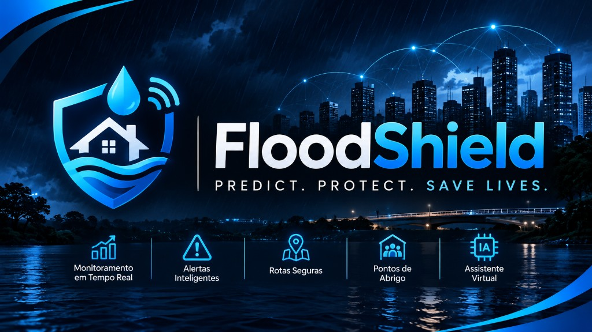

# FloodShield Mobile



**Predict. Protect. Save Lives.**

App React Native (Expo) da CitizenTech **FloodShield** — Global Solution FIAP 2026/2.

| Artefato | Link |
| --- | --- |
| Repositório | https://github.com/FloodShield-2026/FloodShield_Mobile |
| Vídeo (YouTube) | https://youtube.com/shorts/PN0IJp2Mbsk |
| API Java (consumida pelo app) | https://github.com/FloodShield-2026/FloodShield_Java |

## Equipe

| Nome | RM |
| --- | --- |
| Bruno Vinicius Barbosa | 566366 |
| Guilherme de Andrade Martini | 566087 |
| Nathan Gonçalves Pereira Mendes | 564666 |
| Raphael Gomes Mancera | 562279 |

## O que este app cobre (Mobile Application Development)

- Mínimo de **6 telas** com navegação (Expo Router)
- **CRUD** de ocorrências via API Java (`Axios`)
- **Autenticação** real (cadastro, login, logout, rotas protegidas)
- Identidade visual FloodShield (logo, banner/hero, paleta escura + ciano)
- Arquitetura em pastas: `app`, `components`, `services`, `contexts`, `theme`
- Tela **Sobre** com hash do commit (`EXPO_PUBLIC_GIT_COMMIT`)
- Check-in / pedido de ajuda preparado para a API **.NET** com `Idempotency-Key`

### Telas

1. Welcome  
2. Login  
3. Cadastro  
4. Início  
5. Ocorrências (lista)  
6. Nova ocorrência  
7. Detalhe da ocorrência  
8. Abrigos  
9. Plano de ação  
10. Check-in  
11. Sobre (não conta no mínimo de 6)

## Como rodar

```bash
npm install
npx expo start
```

Conta demo: `cidadao@floodshield.app` / `123456`

### Variáveis de ambiente

Copie `.env.example` para `.env`:

```bash
# Local enquanto a API Java roda na sua máquina
EXPO_PUBLIC_JAVA_API_URL=http://localhost:8080

# Quando o DevOps publicar a API Java no Azure, troque pela URL pública
# EXPO_PUBLIC_JAVA_API_URL=https://floodshield-api.azurewebsites.net

# API .NET (check-in) — quando existir
# EXPO_PUBLIC_DOTNET_API_URL=https://app-floodshield-doacoes.azurewebsites.net

EXPO_PUBLIC_GIT_COMMIT=<sha-do-commit>
```

Sem `EXPO_PUBLIC_JAVA_API_URL`, o app usa mock local.  
Na avaliação, a API Java precisa estar no ar.  
**Deploy em nuvem (Azure) é responsabilidade da disciplina de DevOps** — este app só consome a URL.

## Integração multidisciplinar

| Disciplina | Como o Mobile se liga |
| --- | --- |
| **Java Advanced** | CRUD + auth + plano de ação via `EXPO_PUBLIC_JAVA_API_URL` → https://github.com/FloodShield-2026/FloodShield_Java |
| **.NET** | Check-in / doações com `Idempotency-Key` → https://github.com/brunovb002/floodshield-doacoes |
| **DevOps** | Azure DevOps + API publicada → https://dev.azure.com/RM566366/GS%202026%20-%20FloodShield |
| **IA** | Plano de ação no fluxo (`/ai/plano-acao` na API Java) |

## Vídeo

Link público (YouTube): **https://youtube.com/shorts/PN0IJp2Mbsk**

Demonstra autenticação, navegação, CRUD de ocorrências, plano de ação, abrigos e demais fluxos do app.

## Checklist Mobile (enunciado GS)

- [x] ≥ 6 telas + Expo Router
- [x] CRUD via API Java (Axios) — API precisa estar no ar na avaliação
- [x] Auth (cadastro, login, logout, rotas protegidas)
- [x] Estilização / identidade FloodShield
- [x] Arquitetura em pastas
- [x] Tela Sobre com hash do commit
- [x] **Vídeo ≤ 5 min** no YouTube → https://youtube.com/shorts/PN0IJp2Mbsk
- [ ] **Firebase App Distribution** (professor como tester)
- [ ] E-mail do professor como leitor/colaborador no GitHub
- [x] .txt de entrega (grupo, nomes, link vídeo, link repo) em `docs/`

## Uso de IA generativa (declaração do time)

A IA generativa foi usada **apenas como apoio de estudo** (dúvidas, organização de ideias e revisão de conceitos).  
Não substitui o aprendizado nem a responsabilidade do grupo: o código entregue foi desenvolvido, testado e validado pelos integrantes.

## Próximos passos

1. Firebase App Distribution + e-mail do professor como tester  
2. Adicionar o professor como leitor no GitHub  
3. Enviar o zip/txt no Portal do Aluno
